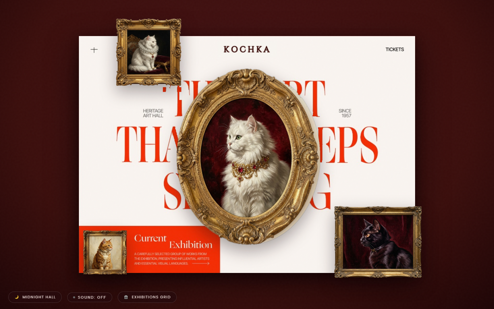
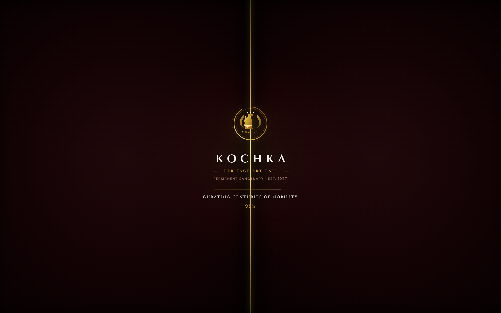

# KOCHKA (КОШКА / قطة)
### Global Digital Museum of Classical & Contemporary Feline Art
*Curating centuries of feline nobility across the Baroque, Renaissance, Dutch Golden Age, and Edo periods.*

---



---

## 🏛️ Overview

**KOCHKA** is an aristocratic, high-fashion digital art sanctuary dedicated to classical and contemporary feline portraiture across centuries. Designed with Baroque revival opulence, deep oxblood velvet, 24k gold leaf filigree, and Renaissance chiaroscuro lighting, KOCHKA transports visitors into an imperial gallery hall.

Built with **vanilla, zero-dependency modern web standards**, the museum features GPU-accelerated spatial perspective, interactive curatorial restoration, deep canvas inspection up to 3.5× magnification, full trilingual support (including native Arabic RTL), and an acoustic chamber atmosphere.

---

## ✨ Core Features

### 1. 🎭 Theatrical Loading Sanctuary & Grand Unveil

- **Aristocratic Medallion Crest**: Hand-crafted 24k gold leaf SVG medallion with crowned feline silhouette, imperial laurels, and Roman numerals `MCM LVII`.
- **Curatorial Restoration Phases**: Smooth sinusoidal ease-out progress through 4 historical restoration stages:
  - *Calibrating Chiaroscuro...*
  - *Restoring Baroque Masterpieces...*
  - *Gilding Rococo Mouldings...*
  - *Curating Centuries of Nobility...*
- **Theatrical Split-Curtain Parting**: Symmetrical oxblood velvet curtain reveal (`cubic-bezier(0.85, 0, 0.15, 1)`) with golden seam lighting, dissolving into the gallery hall with subtle zoom and de-blur.
- **Harmonic Triad Chime**: Web Audio API generated A-major arpeggiated entrance chime.
- **On-Demand Replay**: Click the `KOCHKA` nav insignia or call `window.replayMuseumEntrance()` to replay anytime.

### 2. 🖼️ Spatial 5D Volumetric Canvas & Interactive Frames
- **Three-Dimensional Parallax**: 60/120 FPS physics with realistic 3D tilt, specular sheen glare, and dynamic varnish reflections following the visitor's cursor.
- **Authentic Carved Mouldings**: Antique Rococo and Baroque gilded gold frames, acanthus leaf flourishes, and custom-cut masterworks.

### 3. 🔍 3.5× Ultra-Deep Canvas Zoom Inspector
- Dedicated high-fidelity artwork inspection mode with up to **350% magnification**.
- Micro-impasto oil brushstroke clarity with smooth cursor and touchscreen panning.

### 4. 📜 4 Interactive Curatorial Modals
- **Artwork Details Modal**: Deep curatorial essays, historical provenance, medium, dimensions, and conservation logs.
- **Curatorial Menu Modal**: Aristocratic navigation index with gallery room directions and archives.
- **Sanctuary Tickets Modal**: Interactive imperial reservation system with admission passes and VIP curatorial tours.
- **Masterpiece Collection Modal**: Curated gallery rooms across Dutch Golden Age, Parisian Belle Époque, Edo Period Ukiyo-e, and Ancient Dynasty Bastet artifacts.

### 5. 🌍 Trilingual Global Localization
- **English (`en`)**: Curatorial standard.
- **العربية (`ar`)**: Full Right-to-Left (RTL) layout with tailored Arabic typography.
- **Русский (`ru`)**: Aristocratic Cyrillic localization.
- Instant language switching via the global language toggle or URL query parameter (`?lang=ar`, `?lang=ru`, `?lang=en`).

### 6. 🎻 Acoustic Atmosphere & Lighting Controls
- **Museum Chamber Audio**: J.S. Bach's *Air on the G String* chamber recording with automatic audio ducking during modal explorations.
- **Daylight & Midnight Lighting**: Toggle between moody Renaissance Chiaroscuro candlelight and crisp Daylight museum illumination.

---

## 🚀 Quick Start / Local Setup

The experience runs entirely on native web standards without build tools, package managers, or frameworks.

### Prerequisites
Any modern web browser (Chrome, Edge, Safari, Firefox).

### Run Locally

1. **Clone the repository**:
   ```bash
   git clone https://github.com/<your-username>/kochka-heritage-art-hall.git
   cd kochka-heritage-art-hall
   ```

2. **Start a local HTTP server**:
   Using Python:
   ```bash
   python -m http.server 8080
   ```
   Or using Node.js:
   ```bash
   npx serve .
   ```

3. **Open in your browser**:
   ```
   http://127.0.0.1:8080
   ```

---

## 📁 Repository Structure

```
kochka-heritage-art-hall/
├── index.html          # Semantic HTML5 museum architecture, preloader & modals
├── style.css           # Luxury Baroque revival stylesheet, typography & responsive layouts
├── script.js           # 5D physics, curatorial logic, i18n engine & Web Audio synthesizer
├── assets/             # Masterpiece paintings, antique gilded frames, fonts & audio
│   ├── preview_gallery.png
│   ├── preview_preloader.png
│   ├── Cinzel.ttf
│   ├── Poppins-Regular.ttf
│   ├── museum_ambient_bach_air.mp3
│   └── ...
├── .gitignore          # Clean Git workspace configuration
└── README.md           # Project documentation & curatorial overview
```

---

## 🎨 Typography & Design Tokens

- **Headings & Insignia**: `Cinzel` (Classical Roman Antiqua / Serif)
- **Body & Provenance**: `Poppins` (Refined Humanist Sans)
- **Imperial Palette**:
  - *Oxblood / Garnet Velvet*: `#0B0103` / `#1A0709` / `#2E0B12`
  - *24k Antique Gold Leaf*: `#D4AF37` / `#FFEAA7` / `#85580F`
  - *Warm Canvas Cream*: `#F9F4F0` / `#ECE3DB`
  - *Charcoal Bronze*: `#11100F`

---

## 📜 Curatorial License & Attribution

Designed and engineered for classical and contemporary feline art preservation. Released under the [MIT License](LICENSE).
